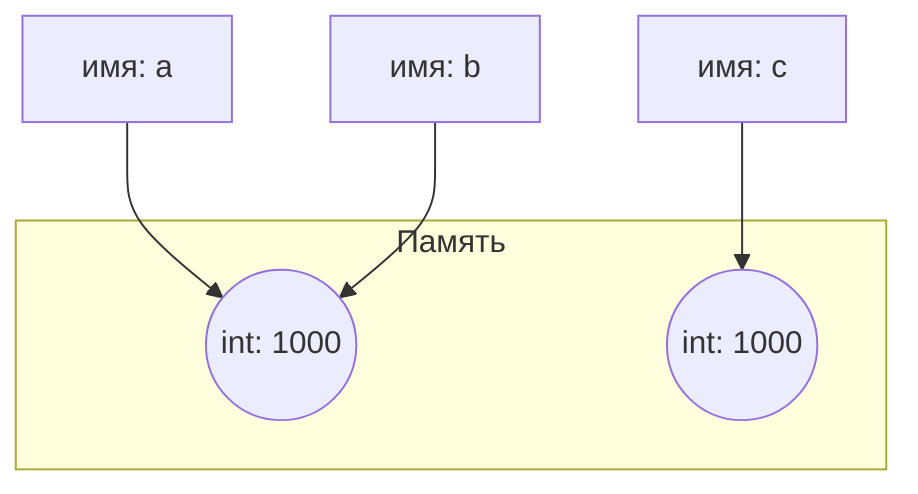

# Отчет по лабораторной работе № 1
**Дисциплина:** Основы программирования  
**Тема:** Выполнение программы, объекты и базовые типы Python 
**Выполнил:** студент гр. К3141 Чмерёв Д.А.
**Преподаватель:** Летенков И.А.
**Дата:** 15.10.2026
**Санкт-Петербург, 2026** 


## Задание 1. От исходного кода к байткоду

### Часть 1. Режимы запуска
При работе в REPL выражение `2 + 3 * 4` автоматически выводит результат на экран, так как этот режим устроен по принципу Read-Eval-Print Loop (считывание, вычисление и автоматический вывод строкового представления объекта). 
При запуске файла `python task_1.py` интерпретатор выполняет вычисления, но не выводит результат в консоль, так как в коде файла отсутствует явная инструкция вывода `print()`. Для отображения результата в терминале код изменен на `print(2 + 3 * 4)`.

### Часть 2. Выражения и инструкции
Для кода:
```python
course = "Python"
hours = 4 * 2
print(f"{course}: {hours} часов")
```
- **Выражения:** `"Python"`, `4 * 2`, `4`, `2`, `f"{course}: {hours} часов"`.
- **Инструкции:** `course = "Python"`, `hours = 4 * 2`, `print(f"{course}: {hours} часов")`.
- **Литералы:** `"Python"`, `4`, `2`.
- **Имена:** `course`, `hours`, `print`.

### Часть 3. AST и байткод
- Версия интерпретатора: Python 3.11
- Фрагмент AST: узлы `Assign` (присваивание), `BinOp` с оператором `Mult` (арифметическое умножение), `Expr` с вложенным `Call` (вызов функции print).
- Фрагмент байткода: инструкции `LOAD_CONST` (загрузка константы) и `CALL` (вызов функции).

### Ответ на контрольный вопрос
Байткод CPython нельзя считать машинным кодом процессора, так как он представляет собой инструкции для виртуальной машины Python (PVM), а не для физического CPU. Процессор компьютера не может выполнять инструкции байткода напрямую, их интерпретирует и выполняет среда CPython.

---

## Задание 2. Имена, объекты и сравнение

### Связь имен и объектов


### Разница между равенством и идентичностью
- `a == b` -> `True` (значения объектов равны).
- `a is b` -> `True` (имена указывают на один и один и тот же объект в памяти после присваивания `b = a`).
- `a == c` -> `True` (значения объектов равны).
- `a is c` -> `False` (имя `c` связано с новым объектом, созданным при явном преобразовании строки).

Равенство значений (`==`) проверяет совпадение содержимого объектов, а идентичность (`is`) проверяет, ссылаются ли переменные на один и тот же адрес памяти.

### Проверка на None
Для измененного значения `c` проверка реализована следующим образом:
```python
c = None
print(c is None)
```

### Эксперимент со строками
Результат выполнения:
- `first == second` -> `True`
- `first is second` -> `True`

Результат `is` объясняется механизмом интернирования строк в CPython, при котором одинаковые строковые литералы, созданные на этапе компиляции, связываются с одним объектом в памяти для экономии ресурсов.

### Правило применения операторов
Оператор `==` применяется для сравнения числовых, строковых и иных значений. Оператор `is` применяется для проверки идентичности объектов, в частности при сравнении с синглтонами (например, `None`, `True`, `False`).

### Ответы на контрольные вопросы
1. Инструкция `b = a` не создает копию объекта, она связывает имя `b` с уже существующим объектом, на который указывает `a`.
2. Функция `type()` возвращает тип (класс) объекта, а `id()` возвращает уникальный целочисленный идентификатор объекта (адрес в памяти).
3. `None` существует в единственном экземпляре в рамках процесса, поэтому проверка через `is` однозначна и работает быстрее. Числа и строки могут находиться в разных объектах памяти, поэтому для них проверяется равенство значений через `==`.

---

## Задание 3. Числовые типы, операции и преобразования

### Эксперимент A
- `x + y = 22` (тип `int`)
- `x - y = 12` (тип `int`)
- `x * y = 85` (тип `int`)
- `x / y = 3.4` (тип `float`)
- `x // y = 3` (тип `int`)
- `x % y = 2` (тип `int`)
- `x ** y = 1419857` (тип `int`)

Оператор `/` выполняет деление и всегда возвращает значение типа `float`. Оператор `//` производит деление нацело с округлением вниз и возвращает `int`, если оба операнда целочисленные.

### Эксперимент B
Значение `2 ** 1000` вычисляется без переполнения. Целые числа в Python имеют произвольную разрядность (ограничены только доступной памятью), в отличие от типов фиксированной разрядности (32 или 64 бита) в других языках.

### Эксперимент C
- `result = 0.30000000000000004`
- `result == 0.3` -> `False`
- `result - 0.3 = 5.551115123125783e-17`
- `math.isclose(result, 0.3)` -> `True`

В памяти компьютера вещественные числа хранятся в двоичном формате IEEE 754. Дроби `0.1` и `0.2` невозможно представить в двоичной системе точно, что приводит к погрешности при их сложении. Правило безопасного сравнения: вещественные числа следует сравнивать с учетом допустимой погрешности с помощью функции `math.isclose()`.

### Эксперимент D
- `int("42")` -> `42` (тип `int`)
- `float("3.14")` -> `3.14` (тип `float`)
- `str(2026)` -> `'2026'` (тип `str`)
- `bool(0)` -> `False` (тип `bool`)
- `bool(-1)` -> `True` (тип `bool`)
- `bool("")` -> `False` (тип `bool`)
- `bool("False")` -> `True` (тип `bool`)

Функция `bool("False")` возвращает `True`, потому что любая непустая строка в Python расценивается как истинное значение.  
Свойства комплексного числа `complex(2, -3)`: действительная часть = `2.0`, мнимая часть = `-3.0`.

### Ответы на контрольные вопросы
1. Деление двух целых чисел может дать дробный результат, поэтому для согласованности математических операций тип вывода зафиксирован как `float`.
2. Функция `int("42")` разбирает текстовые символы строки и переводит их в число. Функция `int(42.9)` отбрасывает дробную часть исходного вещественного числа.
3. Логически ложными (falsy) значениями являются `bool(0)` и `bool("")`.

---

## Задание 4. Строки, Unicode и форматирование

### Попытка изменения символа
Строка кода `student[0] = "О"` закомментирована, так как вызывает ошибку `TypeError: 'str' object does not support item assignment`. Причина заключается в том, что строки в Python относятся к категории неизменяемых объектов.

### Ответы на контрольные вопросы
1. Функция `len(symbol)` считает количество символов в строке, а `len(symbol.encode("utf-8"))` определяет количество байт. Символ `"Я"` в кодировке UTF-8 занимает 2 байта.
2. Параметр `start` задает индекс начала среза (включительно), `stop` — индекс окончания (не включая его), `step` — шаг выборки элементов.
3. Данные методы не изменяют исходную строку, а формируют и возвращают новый строковый объект с измененным текстом.

---

## Задание 5. Информационная карточка вычислительного эксперимента

### Связь имен и типов объектов
- `investigator` — тип `str`
- `experiment_name` — тип `str`
- `runs_count` — тип `int`
- `run_duration` — тип `float`
- `real_part` — тип `float`
- `imag_part` — тип `float`
- `total_duration_sec` — тип `float`
- `total_duration_min` — тип `float`
- `coeff` — тип `complex`
- `squared_modulus` — тип `float`
- `has_runs` — тип `bool`

### Разбор арифметической строки
Строка кода: `total_duration_sec = runs_count * run_duration`
- **Имена:** `total_duration_sec`, `runs_count`, `run_duration`.
- **Операторы:** оператор присваивания `=`, оператор умножения `*`.
- **Литералы:** отсутствуют.
- **Вызовы функций:** отсутствуют.

### Путь программы в CPython
1. **Исходный файл:** Чтение текста программы из файла с расширением `.py`.
2. **Разбор исходного текста:** Разбиение текста на отдельные лексемы (токены) и проверка синтаксиса.
3. **AST:** Генерация абстрактного синтаксического дерева, отображающего иерархическую структуру кода.
4. **Компиляция в байткод:** Перевод дерева AST в набор низкоуровневых команд для виртуальной машины.
5. **Выполнение виртуальной машиной CPython:** Пошаговая интерпретация байткода компонентом PVM и передача команд на исполнение процессору.

### Необходимость явного преобразования результатов `input()`
Функция `input()` возвращает текстовую строку типа `str`. Поскольку в Python запрещены неявные операции между строками и числами, попытка провести с ними математические расчеты приведет к ошибке `TypeError`. Явное приведение через `int()` и `float()` переводит текст в числовые объекты.

### Ответ на контрольный вопрос
При повторном присваивании нового значения существующему имени старая связь имени с объектом разрывается. Имя связывается с новым созданным объектом в памяти. Если на прежний объект больше нет других ссылок, он удаляется из памяти сборщиком мусора.
