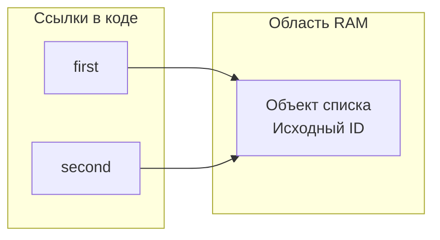
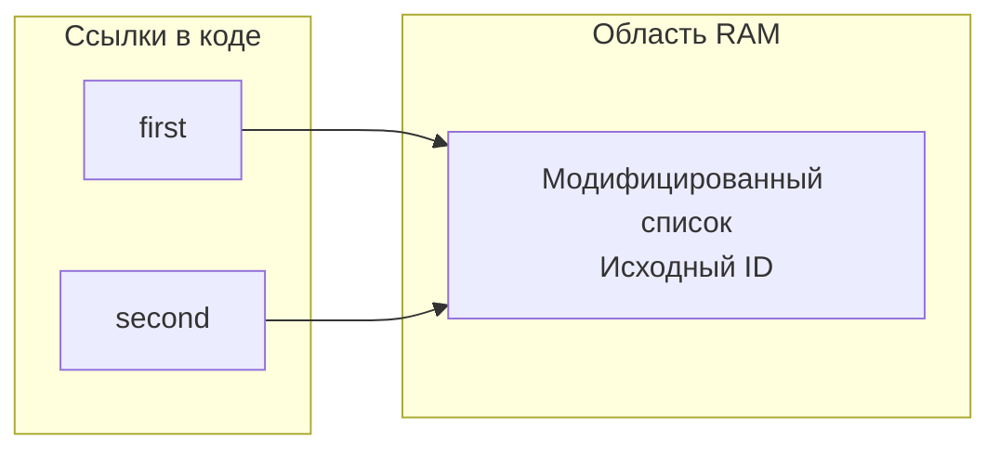
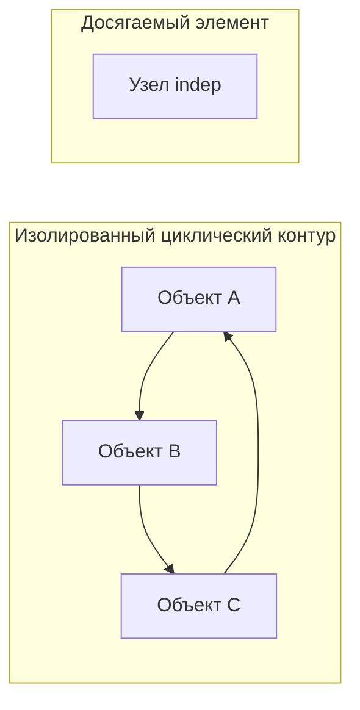

# Отчет по лабораторной работе № 1
**Дисциплина:** Основы программирования  
**Тема:** Лабораторная работа №2: Исследование механизмов управления памятью в Python
**Выполнил:** студент гр. К3141 Чмерёв Д.А.
**Преподаватель:** Летенков И.А.
**Дата:** 29.10.2026
**Санкт-Петербург, 2026** 

## Задание 1: Мутабельность типов данных и поведение ссылок

### Эксперимент A (Неизменяемый тип — int)
**Ожидаемое поведение программы:**  
На начальном этапе переменные `a` и `b` будут обладать абсолютно идентичными значениями и адресами в памяти (id). На втором этапе (после модификации) их значения и уникальные идентификаторы полностью разойдутся.

**Техническое обоснование:**  
При создании объекта обе переменные изначально связываются с одной и той же областью памяти. Поскольку целочисленные значения (`int`) относятся к категории неизменяемых (`immutable`), любая попытка скорректировать переменную `a` вынуждает интерпретатор выделить новый блок памяти под новое значение. В результате имя `a` начинает указывать на новый адрес, тогда как `b` сохраняет связь с исходным объектом.

### Эксперимент B (Изменяемый тип — list)
**Ожидаемое поведение программы:**  
В обоих контрольных случаях идентификаторы объектов (id) для обеих переменных останутся полностью идентичными.

**Техническое обоснование:**  
Изначально переменные `a` и `b` ссылаются на один и тот же динамический список. Так как списки в Python являются изменяемыми объектами (`mutable`), операция добавления нового элемента через `append()` модифицирует существующую структуру данных «на месте». Выделения нового адреса в памяти не происходит, благодаря чему переменные сохраняют связь с единым общим объектом.

**Схема распределения ссылок до модификации:**

**Схема распределения ссылок после модификации:**

### Ответы на вопросы к Заданию 1
1. **Влияет ли операция присваивания на внутреннее состояние объекта?** Нет, эта процедура лишь привязывает имя переменной к определенному адресу существующего в памяти объекта.
2. **По какой причине изменяется id неизменяемого объекта при операциях типа `+=`?** Из-за природы `immutable`-объектов: их нельзя переписать в текущей ячейке памяти. Любое изменение приводит к генерации новой сущности с новым адресом.
3. **При помощи какого инструмента проверяется тождество адресов?** С помощью оператора тождественности `is`.

---

## Задание 2: Сравнительный анализ стратегий копирования объектов

| Метод копирования | Выделение нового внешнего контейнера | Клонирование вложенных элементов | Абсолютная независимость изменений |
| :--- | :---: | :---: | :---: |
| **Обычное присваивание** | Нет | Нет | Нет |
| **Поверхностное копирование (`copy`)** | Да | Нет | Нет |
| **Глубокое копирование (`deepcopy`)** | Да | Да | Да |

### Ответы на вопросы к Заданию 2
1. **Каковы ключевые особенности и риски поверхностного копирования?** Этот метод дублирует только внешнюю оболочку (контейнер). Вложенные изменяемые структуры данных копируются по ссылке, из-за чего их изменение в копии неизбежно исказит данные в оригинале.
2. **В чем заключаются главные минусы тотального использования глубокого копирования?** Это ресурсоемкая операция, требующая полного рекурсивного обхода всех уровней вложенности. Она существенно замедляет работу программы и создает избыточную нагрузку на RAM из-за дублирования множества связанных объектов.
3. **В каких ситуациях поверхностного копирования будет достаточно?** Оно оптимально, если объект является плоским (не содержит вложенных структур), состоит исключительно из неизменяемых типов данных или если логика приложения не предусматривает модификацию внутренних элементов.

---

## Задание 3: Жизненный цикл объектов и типы ссылок в Python

### Ответы на вопросы (Часть 1)
* **Почему при передаче аргумента в функцию увеличивается счетчик ссылок?** При вызове функции создается локальная переменная (формальный параметр), которая начинает ссылаться на переданный объект, тем самым увеличивая число ссылающихся на него имен.
* **Какие действия вызывают увеличение счетчика ссылок?** Привязка нового имени через оператор `=`, вложение объекта в коллекцию (список, словарь) или передача его в локальную область видимости функции.
* **Какие операции уменьшают значение счетчика?** Явное удаление имени переменной через `del`, перезапись переменной другим значением или выход из области видимости (завершение выполнения функции).
* **Каков истинный принцип работы оператора `del`?** Он лишь разрывает связь конкретного имени с объектом и уменьшает счетчик ссылок. Физическое удаление данных из памяти происходит только тогда, когда этот счетчик становится равным нулю.

**Специфика слабых ссылок (`weakref`):**  
Слабые ссылки позволяют обращаться к объекту, но не учитываются внутренним счетчиком жизни. Они незаменимы при реализации кэширования или создании реестров объектов. Пока объект удерживается основными компонентами программы (сильными ссылками), его можно быстро извлечь из кэша по слабой ссылке. Как только сильные ссылки пропадают, объект удаляется сборщиком мусора, предотвращая утечки памяти и неэффективное использование RAM.

### Ответы на вопросы (Часть 2)
1. **В какой момент объект окончательно удаляется из памяти?** Сразу же, как только количество активных сильных ссылок, указывающих на него, становится равным 0.
2. **Всегда ли память мгновенно возвращается операционной системе?** Нет, менеджер памяти Python оптимизирует этот процесс и часто удерживает освободившиеся блоки (обычно размером по 256 КБ) внутри своего пула для быстрого переиспользования под новые объекты без обращения к ОС.
3. **В чем разница между сильной и слабой ссылками?** Сильная ссылка жестко декларирует необходимость нахождения объекта в RAM, продлевая его существование. Слабая ссылка обеспечивает доступ к объекту, но не препятствует его плановому удалению сборщиком мусора.

---

## Задание 4: Циклические зависимости и сборка мусора (Garbage Collection)

Классического механизма подсчета ссылок недостаточно для полноценной очистки памяти, поскольку объекты могут ссылаться друг на друга по кругу, образуя изолированные циклы. Даже если удалить все внешние переменные из кода, счетчики внутренних ссылок внутри этого кольца никогда не обнулятся, хотя данные станут полностью недосягаемы для разработчика. Для поиска и деструктуризации таких изолированных цепочек применяется встроенный сборщик мусора (`gc`).

Для минимизации накладных расходов сборщик разделяет объекты по **поколениям**:
* **Поколение 0:** Сюда попадают абсолютно все новые объекты. Чистка здесь происходит максимально часто, так как короткоживущие переменные создаются и умирают очень быстро.
* **Поколение 1:** Сюда переносятся объекты, устоявшие после проверок в нулевом поколении. Частота их сканирования снижается.
* **Поколение 2:** Место хранения долгоживущих объектов (например, модулей или глобальных конфигураций). Сканируется крайне редко из-за высокой вычислительной стоимости процесса.

Такой подход позволяет экономить процессорное время, оперативно уничтожая временный мусор и не затрагивая стабильные структуры.

### Ответы на вопросы к Заданию 4
1. **Что провоцирует появление циклической ссылки?** Взаимное перекрестное присваивание атрибутов или элементов структур данных друг другу (или объекта самому себе).
2. **Почему классический подсчет ссылок бессилен перед циклами?** Взаимное удержание ссылок внутри кольца не позволяет значениям счетчиков упасть до нуля, маскируя мусор от стандартного деаллокатора.
3. **Зачем нужна концепция поколений в сборщике мусора?** Это критически важно для оптимизации производительности: регулярное сканирование всей памяти подряд привело бы к критическому замедлению работы интерпретатора.

---

## Задание 5: Архитектура хранения данных в контейнерах

Размер контейнера, возвращаемый встроенными инструментами (например, `sys.getsizeof()`), учитывает исключительно емкость самой структуры и массив указателей на элементы, но не включает физический вес самих объектов, находящихся внутри.

### Аналитические выводы и наблюдения:
* **Динамика роста списков:** Выделение памяти под список происходит не поштучно для каждого нового элемента, а крупными блоками с определенным запасом (оверхэдом).
* **Причина оверхэда:** Перераспределение памяти на низком уровне — ресурсоемкая задача (требуется выделить новый непрерывный участок памяти и скопировать туда текущие ссылки). Python минимизирует эти операции, наращивая шаг резервирования по мере роста контейнера.
* **Длина против объема:** Параметр `len()` показывает фактическое число элементов в списке, тогда как задействованная память отражает общий зарезервированный размер внутреннего буфера.

**Сравнение материализованных последовательностей и объектов-генераторов (на примере `range`):**  
Материализованный список хранит все элементы одновременно, и его размер в памяти растет линейно вместе с объемом данных. В отличие от него, объект `range` содержит лишь математическую формулу генерации последовательности (параметры `start`, `stop`, `step`). Его размер в памяти является константным и минимальным, независимо от того, генерирует он 10 чисел или 10 миллиардов, что делает его колоссально выгодным при итерациях по большим массивам данных.

---

## Итоговый анализ: Рекомендации по оптимизации памяти в Python

1. **Контроль копирования:** Отдавать предпочтение обычному присваиванию или поверхностному копированию. Глубокое копирование (`deepcopy`) применять только при явной необходимости полной изоляции вложенных изменяемых данных.
2. **Использование слабых ссылок:** Применять пространство `weakref` для построения внутренних кэшей, чтобы избежать искусственного продления жизни ненужных объектов.
3. **Устранение циклов:** Не допускать перекрестного связывания объектов без явной необходимости. При проектировании сложных графов своевременно настраивать или принудительно вызывать сборщик мусора.
4. **Ленивые вычисления:** Повсеместно внедрять генераторы и объекты типа `range` вместо создания гигантских материализованных массивов данных в памяти.

> **Важное замечание:** Наиболее критичные и опасные ошибки при работе с изменяемыми файлами и структурами данных связаны с некорректным выбором между операциями присваивания, поверхностного клонирования и глубокой копии.